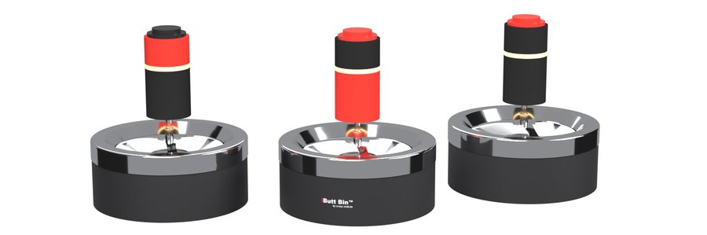

# Ciggie Counter for Home Assistant

Count your cigarettes in Home Assistant, pace yourself with breaks and get reminders – standalone, no other app needed. Optionally it syncs with the [Ciggie Counter Android app and the Nextcloud app](https://github.com/gh0stless/ciggie-counter).

*Deutsch: Zigaretten in Home Assistant zählen, Pausen einhalten, Erinnerungen bekommen – eigenständig, oder im Abgleich mit der Android-App und der Nextcloud-App. Die Oberfläche gibt es auf Deutsch und Englisch.*

## Features

- **Count** with a button entity, the action `ciggie_counter.count`, by voice (Assist) – or with **any entity you already have**: a Zigbee button, a door contact on the ashtray, a switch, an event entity. Each press counts one cigarette.
- **Sensors:** today, yesterday, this month, this year, cost today, current break, next allowed, last cigarette, Butt Bin battery
- **Breaks:** fixed, or calculated from a daily target over your waking hours (smoke faster and the breaks get longer); binary sensor *Allowed*
- **Reminders** as events – "You may smoke again" and "Did you count them all?" – so you decide in an automation how they reach you (TTS, Telegram, a light …)
- **Mute switch** for everything, e.g. at night
- **Your day, your rules:** choose the hour at which a new day starts
- **Sync API** for the Android app, same protocol as the Nextcloud app (sync v2)
- **Optional sync with Nextcloud** (app "cigarettecounter" from 0.9.11): Home Assistant takes over all entries from there and keeps both in step

## Installation

1. HACS → ⋮ → *Custom repositories* → add `https://github.com/gh0stless/ciggie-counter-ha` as *Integration*.
2. Install **Ciggie Counter**, restart Home Assistant.
3. Settings → Devices & services → *Add integration* → **Ciggie Counter**.
4. *Configure* for cost, breaks, reminders and the entities that should count.

Manual: copy `custom_components/ciggie_counter` to `config/custom_components/`.

## Entities

| Entity | |
|---|---|
| `button.ciggie_counter_count_cigarette` | count one |
| `sensor.ciggie_counter_today` / `_yesterday` / `_this_month` / `_this_year` | counts |
| `sensor.ciggie_counter_cost_today` | in your currency |
| `sensor.ciggie_counter_break` | minutes |
| `sensor.ciggie_counter_next_allowed`, `sensor.ciggie_counter_last_cigarette` | timestamps |
| `binary_sensor.ciggie_counter_allowed` | on = break is over |
| `switch.ciggie_counter_mute_reminders` | no reminder events while on |
| `sensor.ciggie_counter_butt_bin_battery` | reported by the Android app |

Entity IDs follow your language; the table shows the English ones.

### Dashboard example

Only built-in cards. Dashboard → ✏️ → *Add card* → *Manual*, paste, adjust the entity IDs if yours are German:

```yaml
type: vertical-stack
cards:
  - type: tile
    entity: button.ciggie_counter_count_cigarette
    name: Count one
    icon: mdi:smoking
    tap_action:
      action: perform-action
      perform_action: button.press
      target:
        entity_id: button.ciggie_counter_count_cigarette
  - type: glance
    entities:
      - entity: sensor.ciggie_counter_today
        name: Today
      - entity: sensor.ciggie_counter_yesterday
        name: Yesterday
      - entity: sensor.ciggie_counter_cost_today
        name: Cost
      - entity: binary_sensor.ciggie_counter_allowed
        name: Allowed
  - type: entities
    entities:
      - entity: sensor.ciggie_counter_next_allowed
        name: Next allowed
        format: relative
      - entity: sensor.ciggie_counter_last_cigarette
        name: Last one
        format: relative
      - entity: sensor.ciggie_counter_break
        name: Break
      - entity: switch.ciggie_counter_mute_reminders
        name: Mute reminders
      - entity: sensor.ciggie_counter_butt_bin_battery
        name: Butt Bin battery
  - type: statistics-graph
    title: Last 30 days
    entities:
      - sensor.ciggie_counter_today
    stat_types:
      - max
    period: day
    days_to_show: 30
    chart_type: bar
  - type: button
    name: Delete last
    icon: mdi:undo
    tap_action:
      action: perform-action
      perform_action: ciggie_counter.delete_last
      confirmation:
        text: Delete the last cigarette?
```

The daily bar chart needs long-term statistics for `sensor.ciggie_counter_today`; it fills from the day you install the integration.

## Actions

- `ciggie_counter.count` – optional `timestamp` (for a cigarette you forgot) and `source`
- `ciggie_counter.delete_last` – e.g. after a double press

## Events

| Event | Data |
|---|---|
| `ciggie_counter_reminder` | `type`: `next_allowed` or `count_check` (not fired while muted) |
| `ciggie_counter_counted` | `number` (today), `source`, `timestamp`, `muted` – only for fresh entries, not for backfills |

### Blueprint: TTS & Telegram

The easiest way to hear the reminders: import the blueprint and create an automation from it.

[](https://my.home-assistant.io/redirect/blueprint_import/?blueprint_url=https%3A%2F%2Fgithub.com%2Fgh0stless%2Fciggie-counter-ha%2Fblob%2Fmain%2Fblueprints%2Fautomation%2Fciggie_counter%2Fannounce.yaml)

- "You may smoke again", "Did you count them all?" and optionally every counted cigarette ("Cigarette number 12 counted.") – texts configurable, e.g. in German
- TTS engine and speaker of your choice, Telegram (or any notify entity) in parallel
- quiet at night (schedule helper), with a do-not-disturb switch, TTS only when someone is home
- silent while `switch.ciggie_counter_mute_reminders` is on

Or by hand – example: speak the reminders.

```yaml
automation:
  - alias: "Cigarette reminders"
    mode: queued
    triggers:
      - trigger: event
        event_type: ciggie_counter_reminder
    actions:
      - action: tts.speak
        target:
          entity_id: tts.piper
        data:
          media_player_entity_id: media_player.living_room
          message: >
            {{ 'You may smoke again.' if trigger.event.data.type == 'next_allowed'
               else 'Did you count all your cigarettes?' }}
```

Example: mute at night.

```yaml
automation:
  - alias: "Cigarette reminders quiet at night"
    triggers:
      - trigger: time
        at: "23:00:00"
        id: "on"
      - trigger: time
        at: "07:00:00"
        id: "off"
    actions:
      - action: "switch.turn_{{ trigger.id }}"
        target:
          entity_id: switch.ciggie_counter_mute_reminders
```

## The Butt Bin



*Design study (AI render). The prototype is being built.*

The **Butt Bin** is an ashtray that counts by itself: you stub out the cigarette and push the knob down – the cigarette drops inside and is counted, with the time. It keeps every entry even when no phone or Home Assistant is around and hands them over via Bluetooth Low Energy later.

- **Inside the knob:** a small Bluetooth chip (Telink TLSR8253), a sealed push switch, a ring of 9 LEDs and a CR2450 coin cell that should last years – no cable, no charging.
- **Counts on its own:** a ring buffer with timestamps; nothing is lost and nothing is counted twice when it syncs.
- The Ciggie Counter Android app collects the entries via Bluetooth and passes them on to Home Assistant or Nextcloud over HTTPS, together with the battery level (`sensor.ciggie_counter_butt_bin_battery`). That works anywhere your phone has internet – no Bluetooth proxy at home needed.
- **Later:** room air sensor, scent sprayer and a small display – the API already has fields for them.

Firmware, schematic and board are open source in the [main repository](https://github.com/gh0stless/ciggie-counter); more at [crazy-midi.de](https://crazy-midi.de). No Butt Bin? Use any button or contact you like (see *Features*).

## Sync with Nextcloud

Optional, under *Configure*: Nextcloud address, user and an **app password** (Nextcloud → Settings → Security). Home Assistant checks the connection when you save.

- The first sync takes over all entries from Nextcloud.
- Then every 5 minutes and shortly after every change: Home Assistant sends its own new entries and deletions (and those it got from a phone) and fetches only what changed on Nextcloud.
- The mute switch is synced too.
- The **rules** are synced as well (Nextcloud app 0.11.0 or newer): cost, start of day, break mode, daily target, wake hours, fixed minutes and the count reminder interval. The latest change wins, wherever it was made. How each device reminds you (notification, push, announcement) stays separate.
- `sensor.ciggie_counter_last_nextcloud_sync` (diagnostic, disabled by default) shows the last successful sync; failures are logged.

Entries that reach Home Assistant from Nextcloud fire `ciggie_counter_counted` as well (if they are fresh). If Nextcloud already announces via its own webhook, use one of the two for announcements.

## Sync with the Android app

The Android app can use Home Assistant instead of (or besides) Nextcloud: enter your Home Assistant URL (also from outside, e.g. Nabu Casa or your own domain) and a **long-lived access token** (your profile → Security). *Supported from Android app version 1.0.7; from 1.0.13 the rules are synced too, the latest change wins.*

> **A small piece of unsolicited advice 🤓:** your phone does not belong in your home network. It runs dozens of apps you cannot look into, so put it in the **guest Wi-Fi** and keep your servers, NAS and smart home in the main network. Ciggie Counter is built for that: the phone talks to Home Assistant or Nextcloud over **HTTPS** like any other device on the internet – no open ports towards the phone, no local network access needed.

API, all under `/api/ciggie_counter`, Home Assistant authentication (Bearer token):

| | |
|---|---|
| `GET /today` | summary |
| `GET /v2/entries?since=N` | records changed after revision N: `{"rev", "entries": [{"id", "ts", "source", "deleted", "rev"}]}` |
| `POST /v2/entries` | JSON `{"entries": [{"id", "ts", "source", "deleted"}]}` – unknown IDs are added, a tombstone always wins |
| `GET`/`POST /mute` | `{"muted": bool}`, POST `muted=1`/`0` |
| `GET`/`POST /ashtray` | Butt Bin state (battery, firmware; placeholders for air quality, spray, display) |

Every cigarette has its own ID, so several entries in the same second stay separate, and deletions reach every device.

## Not a medical product

Ciggie Counter helps you see how much you smoke. It does not give medical advice.

## License

GPL-3.0 – © gh0stless ([crazy-midi.de](https://crazy-midi.de))
